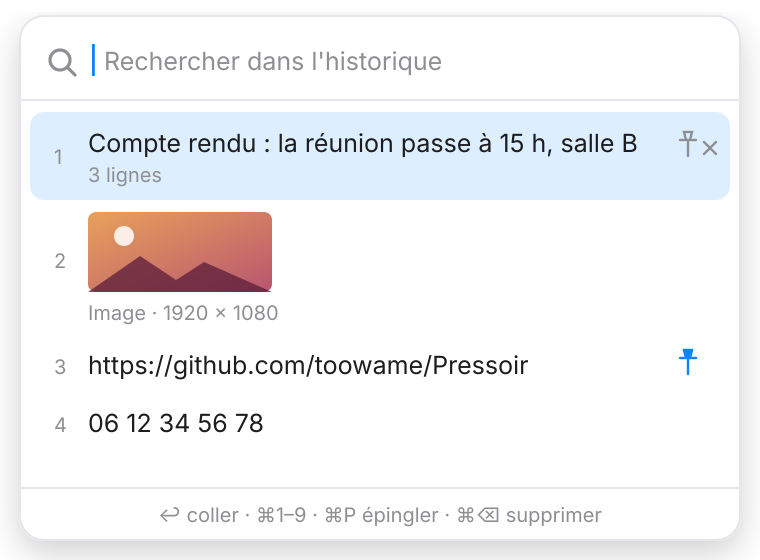
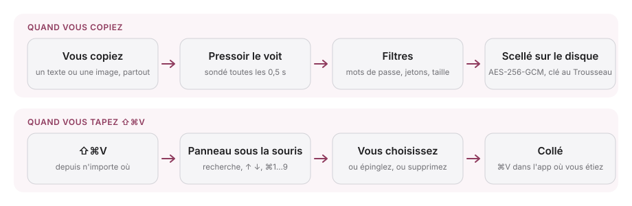

<div align="center">

[English](README.md) · **Français**


# Pressoir : le Win + V de votre Mac

### Un historique du presse-papier qui s'ouvre juste sous la souris.

**Copiez autant que vous voulez. ⇧⌘V, choisissez, c'est collé.**

[](https://github.com/toowame/Pressoir/actions/workflows/ci.yml)
[](https://github.com/toowame/Pressoir/releases/latest)
[](#installer)
[](#construire-depuis-les-sources)
[](#confidentialité-et-sécurité)
[](LICENSE)

[Installer](#installer) · [Fonctionnement](#fonctionnement) · [Ce qu'il garde](#ce-que-pressoir-garde-et-ce-quil-ne-fait-jamais) · [Clavier](#clavier) · [Confidentialité](#confidentialité-et-sécurité) · [FAQ](#faq) · [Construire](#construire-depuis-les-sources)

<kbd>⇧</kbd> <kbd>⌘</kbd> <kbd>V</kbd>

</div>

> [!IMPORTANT]
> Téléchargez Pressoir uniquement depuis la [page Releases de toowame/Pressoir](https://github.com/toowame/Pressoir/releases).
> Un gestionnaire de presse-papier voit tout ce que vous copiez : un dépôt au nom ressemblant ou un DMG
> republié ailleurs n'est pas une version officielle.

<div align="center">

<br />

<picture>
  <source media="(prefers-color-scheme: dark)" srcset="docs/images/panel-dark.svg" />
  
</picture>

<br /><br />

</div>

---

macOS ne garde qu'une seule chose dans le presse-papier : copiez autre chose, la précédente disparaît.
Pressoir retient discrètement vos 50 dernières copies, textes et images, et vous les rend d'un
raccourci, sous le pointeur, sur l'écran où vous travaillez.

Pas de fenêtre à gérer, pas d'icône dans le Dock, pas de compte, pas d'accès réseau. L'historique est
chiffré sur le disque, les gestionnaires de mots de passe sont ignorés et les identifiants
reconnaissables ne sont jamais enregistrés. C'est une app Swift native d'environ 450 Ko, sans
dépendance tierce.

## Installer

1. Téléchargez `Pressoir-x.y.z.dmg` depuis la [dernière version](https://github.com/toowame/Pressoir/releases/latest).
2. Ouvrez-le et glissez **Pressoir** dans **Applications**.
3. L'app n'est pas notariée par Apple, le premier lancement est donc bloqué. Clic droit sur Pressoir →
   **Ouvrir**, ou **Réglages Système → Confidentialité et sécurité** → **Ouvrir quand même**.
4. Une icône presse-papier apparaît dans la barre de menu. Activez **Ouvrir au démarrage** depuis son
   menu si vous voulez.

À la première utilisation, macOS demande deux autorisations :

| Autorisation      | Pourquoi                                                     | Sans elle                                               |
| ----------------- | ------------------------------------------------------------ | ------------------------------------------------------- |
| **Accessibilité** | Taper <kbd>⌘V</kbd> dans l'app où vous étiez                  | L'élément est copié ; faites <kbd>⌘V</kbd> vous-même     |
| **Trousseau**     | Lire la clé de chiffrement de l'historique (mot de passe de session, puis **Toujours autoriser**) | Historique en mémoire seulement, rien n'est écrit        |

Les versions sont signées ad hoc : macOS peut redemander les deux après une mise à jour.

## Fonctionnement

Pressoir surveille le presse-papier, filtre ce qu'il voit et scelle ce qu'il garde. Au raccourci, il
affiche l'historique sous la souris et colle votre choix dans l'app qui était au premier plan.

<picture>
  <source media="(prefers-color-scheme: dark)" srcset="docs/images/flow-fr-dark.svg" />
  
</picture>

- macOS n'émet pas d'événement « presse-papier modifié » : son compteur de changements est lu toutes les 0,5 s.
- Le raccourci global passe par `RegisterEventHotKey`, qui ne demande aucune autorisation.
- Le panneau est un `NSPanel` non activant : l'app en dessous garde le focus et reçoit le collage.

## Ce que Pressoir garde (et ce qu'il ne fait jamais)

| Situation                                                                   | Ce qui se passe                          |
| --------------------------------------------------------------------------- | ---------------------------------------- |
| Un texte copié                                                              | Gardé, jusqu'à 1 Mo par élément          |
| Images et captures d'écran                                                  | Gardées en image, jusqu'à 50 Mo ou 64 Mpx |
| La même copie deux fois                                                     | Remontée en tête, sans doublon           |
| Éléments épinglés                                                           | Restent en tête et n'expirent jamais     |
| Copies marquées confidentielles ou transitoires ([nspasteboard.org](http://nspasteboard.org)) | Jamais enregistrées                      |
| Tout ce qui est copié depuis 1Password, Bitwarden, KeePassXC, Mots de passe, Trousseau d'accès, Dashlane ou Enpass | Jamais enregistré                        |
| Jetons GitHub, AWS, Slack, Stripe, Google, OpenAI ou Anthropic, JWT, clés privées | Jamais enregistrés                       |
| Ce qui vient d'un autre appareil Apple (presse-papier universel)            | Jamais enregistré                        |
| Fichiers copiés dans le Finder                                              | Pas encore gérés                         |

## Clavier

| Touches                               | Action                                               |
| ------------------------------------- | ---------------------------------------------------- |
| <kbd>⇧</kbd><kbd>⌘</kbd><kbd>V</kbd>    | Ouvrir / fermer l'historique (modifiable depuis le menu) |
| taper                                 | Rechercher (sans casse ni accents, textes seulement) |
| <kbd>↑</kbd> <kbd>↓</kbd> <kbd>↩</kbd> | Naviguer, coller                                     |
| <kbd>⌘1</kbd> … <kbd>⌘9</kbd>          | Coller l'élément 1 à 9                               |
| <kbd>⌘P</kbd>                          | Épingler / désépingler                               |
| <kbd>⌘⌫</kbd>                          | Supprimer l'élément                                  |
| <kbd>Échap</kbd> ou clic ailleurs      | Fermer                                               |

## Confidentialité et sécurité

Tout reste sur votre Mac. Pressoir ne fait aucune requête réseau.

- **Stockage chiffré.** `~/Library/Application Support/Pressoir/` contient `history.enc` et un fichier
  scellé par image, sous un nom aléatoire. AES-256-GCM, droits réservés au propriétaire, exclu de Time
  Machine. La clé est dans votre Trousseau de session, jamais synchronisée avec iCloud, et ne quitte
  jamais ce Mac.
- **Collage prudent.** Le <kbd>⌘V</kbd> ne part que vers l'app au premier plan à l'ouverture du
  panneau, jamais dans un champ mot de passe.
- **Rien n'est jamais écrasé.** Si l'historique ne se déchiffre plus (clé perdue, fichier abîmé), il
  est mis de côté intact dans `quarantaine-<date>/`, et le menu vous prévient.
- **Invisible au partage d'écran.** Le panneau n'apparaît ni dans les captures ni dans les écrans partagés.
- **Journal discret.** `~/Library/Logs/Pressoir.log` note des événements et des codes d'erreur, jamais
  ce que vous copiez.

Un mot de passe copié depuis une app qui ne le signale pas est enregistré comme n'importe quel texte.
Supprimez-le avec <kbd>⌘⌫</kbd>, ou **Effacer l'historique** dans le menu. Le raisonnement derrière
chaque choix est dans [`docs/adr/`](docs/adr/README.md).

## FAQ

<details>
<summary><strong>Pourquoi macOS dit que l'app ne peut pas être ouverte ?</strong></summary>

Pressoir est signé ad hoc, sans notarisation par un compte développeur Apple payant. Clic droit sur
l'app puis **Ouvrir**, ou **Ouvrir quand même** dans **Réglages Système → Confidentialité et
sécurité**. Une seule fois suffit.

</details>

<details>
<summary><strong>Pourquoi l'Accessibilité ?</strong></summary>

Pour envoyer <kbd>⌘V</kbd> à l'app où vous étiez, afin que l'élément arrive sous votre curseur. Sans
elle, Pressoir met quand même l'élément dans le presse-papier ; vous faites <kbd>⌘V</kbd> vous-même.
Le raccourci, lui, ne demande aucune autorisation.

</details>

<details>
<summary><strong>Le menu dit que l'historique est verrouillé. Que s'est-il passé ?</strong></summary>

Pressoir n'a pas pu lire sa clé dans le Trousseau, en général parce que la demande du Trousseau a été
refusée ou est apparue pendant que l'écran était verrouillé. Rien n'est perdu et rien n'est écrit en
attendant : quittez Pressoir, relancez-le, puis saisissez votre mot de passe de session et cliquez
sur **Toujours autoriser**.

</details>

<details>
<summary><strong>L'historique se synchronise-t-il entre mes Mac ?</strong></summary>

Non. La clé est rangée avec un accès « cet appareil uniquement », et l'historique ne quitte jamais le
Mac où il a été copié.

</details>

<details>
<summary><strong>Je peux choisir un autre raccourci ?</strong></summary>

Oui. Cliquez sur l'icône de la barre de menu, choisissez **Raccourci : ⇧⌘V…** et tapez la nouvelle
combinaison. Il faut ⌘, ⌃ ou ⌥, et les combinaisons qui appartiennent à macOS (⌘C, ⌘V, ⇧⌘4…) sont
refusées. Si une autre app l'utilise déjà, Pressoir le signale et garde l'ancien.

</details>

<details>
<summary><strong>Comment tout supprimer ?</strong></summary>

Quittez Pressoir, supprimez l'app, puis supprimez `~/Library/Application Support/Pressoir/`,
`~/Library/Logs/Pressoir.log` et, dans **Trousseau d'accès**, l'élément « Pressoir — clé de
l'historique ».

</details>

## Construire depuis les sources

Prérequis : macOS 14+, Xcode 16+ (Swift 6).

```bash
git clone https://github.com/toowame/Pressoir.git
cd Pressoir
swift test                     # tests du domaine
Scripts/check-coverage.sh      # seuil de couverture (≥ 80 %) sur PressoirCore
Scripts/build-app.sh           # Pressoir.app universel (arm64 + x86_64)
Scripts/build-dmg.sh           # .dmg à glisser-déposer
open Pressoir.app
```

```
Sources/
├── PressoirCore/   domaine, sans AppKit : historique immuable, politique de capture,
│                   garde du collage, ouverture du coffre, stockages chiffrés. Testé.
└── PressoirApp/    adaptateurs : sonde du presse-papier, raccourci global (Carbon),
                    Trousseau, ⌘V synthétique, barre de menu, panneau SwiftUI.
```

## Documentation

- [Décisions d'architecture](docs/adr/README.md) : Swift natif, données sensibles, chiffrement, images, durcissement, publication, raccourci et langues.
- [Recette manuelle](docs/TESTING.md) : les vérifications que les tests unitaires ne couvrent pas.
- [Changelog](CHANGELOG.md) : les changements de chaque version (en anglais).
- [Contribuer](CONTRIBUTING.md) : installation, organisation du code, pull requests (en anglais).

Signalez une vulnérabilité via [SECURITY.md](SECURITY.md).

## Contribuer

[Ouvrez une issue](https://github.com/toowame/Pressoir/issues) pour signaler un bug ou proposer une
idée, ou [envoyez une pull request](https://github.com/toowame/Pressoir/pulls).

`brew install lefthook gitleaks && lefthook install` lance sur votre machine les mêmes vérifications
que la CI : format, build et recherche de secrets avant chaque commit, tests et couverture avant
chaque push.

## Licence

[MIT](LICENSE)
