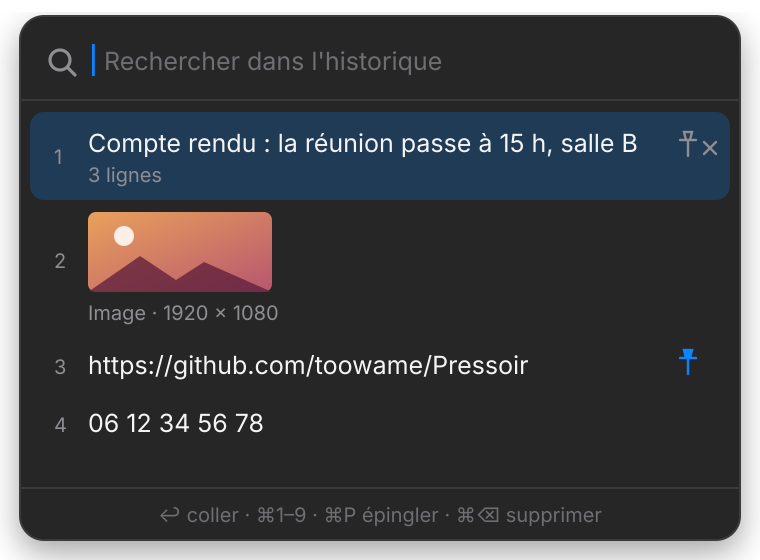

<p align="center">
  
</p>

<h1 align="center">Pressoir</h1>

<p align="center">
  <strong>A clipboard history for macOS, the way Windows does it (Win + V).</strong><br>
  Press <kbd>⇧</kbd><kbd>⌘</kbd><kbd>V</kbd>: your recent copies open right under the mouse. Pick one, it is pasted.
</p>

<p align="center">
  <a href="https://github.com/toowame/Pressoir/actions/workflows/ci.yml"></a>
  
  
  <a href="LICENSE"></a>
</p>

<p align="center">
  <a href="README.fr.md">Lire en français</a>
</p>

<p align="center">
  
</p>

## Why

macOS keeps exactly one thing on the clipboard. Copy something new and the previous one is gone.
Pressoir quietly remembers your last 50 copies, text and images, and brings them back with one
shortcut, where your mouse is. No window to manage, no Dock icon, no account, no network.

## Features

- **Opens under the mouse.** The panel appears at the pointer and stays on screen near edges and on every display.
- **Text and images.** Screenshots and copied pictures show as thumbnails and paste back as images.
- **Keyboard first.** Type to search, <kbd>↑</kbd> <kbd>↓</kbd> <kbd>↩</kbd> to paste, <kbd>⌘1</kbd>…<kbd>⌘9</kbd> for the first nine.
- **Pins.** Pinned entries stay on top and never expire.
- **Pastes for you.** The chosen entry goes straight into the app you were using.
- **Encrypted at rest.** History and images are sealed with AES-256-GCM; the key lives in your Keychain.
- **Tiny and native.** Swift, AppKit and SwiftUI, no third-party dependency, ~450 KB, Apple Silicon and Intel.

## Install

1. Download `Pressoir-x.y.z.dmg` from the [latest release](https://github.com/toowame/Pressoir/releases/latest).
2. Open it and drag **Pressoir** to **Applications**.
3. First launch: the app is not notarized by Apple, so macOS blocks it. Right-click Pressoir → **Open**,
   or go to **System Settings → Privacy & Security** and click **Open Anyway**.
4. Pressoir lives in the menu bar (clipboard icon). Turn on **Launch at login** from its menu if you like.

### Permissions

| Permission | Why | Without it |
|---|---|---|
| **Accessibility** | To type <kbd>⌘V</kbd> into the app you were using | The entry is still copied; press <kbd>⌘V</kbd> yourself |
| **Keychain** | To store the encryption key of your history | History is kept in memory only, nothing is written |

Builds are ad-hoc signed, so macOS may ask for both again after an update.

## Keyboard

| Keys | Action |
|---|---|
| <kbd>⇧</kbd><kbd>⌘</kbd><kbd>V</kbd> | Open / close the history |
| type | Search (case and accent insensitive, text only) |
| <kbd>↑</kbd> <kbd>↓</kbd> <kbd>↩</kbd> | Move, paste |
| <kbd>⌘1</kbd> … <kbd>⌘9</kbd> | Paste entry 1 to 9 |
| <kbd>⌘P</kbd> | Pin / unpin |
| <kbd>⌘⌫</kbd> | Delete the entry |
| <kbd>Esc</kbd> or click outside | Close |

## Privacy and security

Everything stays on your Mac. Pressoir makes no network request.

- **Encrypted storage.** `~/Library/Application Support/Pressoir/` holds `history.enc` and one sealed file per image
  (random names), AES-256-GCM, owner-only permissions, excluded from Time Machine.
- **Never recorded:**
  - copies flagged as concealed or transient by password managers ([nspasteboard.org](http://nspasteboard.org) markers);
  - anything copied while 1Password, Bitwarden, KeePassXC, Passwords, Keychain Access, Dashlane or Enpass is in front;
  - recognisable credentials: GitHub, AWS, Slack, Stripe, Google, OpenAI and Anthropic tokens, JWTs, private keys;
  - content coming from another Apple device (Universal Clipboard), text over 1 MB, images over 50 MB or 64 Mpx.
- **Careful pasting.** <kbd>⌘V</kbd> is only sent to the app that was in front when you opened the panel, and never into
  a password field.
- **Nothing is ever overwritten.** If the history cannot be decrypted (lost key, damaged file), it is moved aside to
  `quarantaine-<date>/` untouched, and the menu tells you.
- **Hidden from screen sharing.** The panel does not appear in screenshots or shared screens.
- The log (`~/Library/Logs/Pressoir.log`) records events and error codes, never what you copied.

Limits worth knowing: a password copied from an app that does not flag it is recorded like any text. Delete it
with <kbd>⌘⌫</kbd> or use **Clear history** in the menu. The full reasoning is in [`docs/adr/`](docs/adr).

## Build from source

Requirements: macOS 14+, Xcode 16+ (Swift 6).

```bash
git clone https://github.com/toowame/Pressoir.git
cd Pressoir
swift test                     # domain tests
Scripts/check-coverage.sh      # coverage gate (≥ 80 %) on PressoirCore
Scripts/build-app.sh           # universal Pressoir.app (arm64 + x86_64)
Scripts/build-dmg.sh           # drag-to-install .dmg
open Pressoir.app
```

For contributors: `brew install lefthook gitleaks && lefthook install` runs format, build and secret checks before
each commit, and tests before each push, like the CI.

## How it works

```
Sources/
├── PressoirCore/   domain, no AppKit: immutable history, capture policy, paste guard,
│                   vault opening, encrypted stores. Unit-tested.
└── PressoirApp/    adapters: pasteboard polling, global hotkey (Carbon), Keychain,
                    synthetic ⌘V, menu bar, SwiftUI panel.
```

- macOS has no "clipboard changed" event: the pasteboard change count is polled every 0.5 s.
- The global shortcut uses `RegisterEventHotKey`, which needs no permission.
- The panel is a non-activating `NSPanel`: the app underneath stays in front and receives the paste.

Design decisions are recorded as ADRs in [`docs/adr/`](docs/adr). Manual test plan: [`docs/TESTING.md`](docs/TESTING.md).

## Roadmap

- Configurable shortcut and excluded apps
- Copied files (Finder)
- Optional expiry of unpinned entries
- Signed and notarized builds

## License

[MIT](LICENSE). Interface in French; contributions to localise it are welcome.
