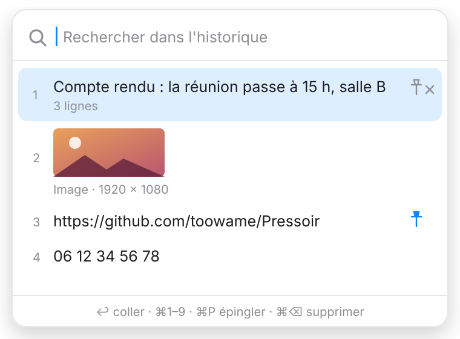
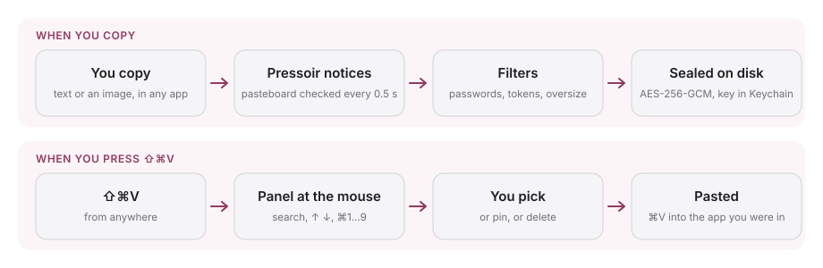

<div align="center">

**English** · [Français](README.fr.md)


# Pressoir: Win + V for your Mac

### A clipboard history that opens right under your mouse.

**Copy as much as you like. Press ⇧⌘V, pick, it's pasted.**

[](https://github.com/toowame/Pressoir/actions/workflows/ci.yml)
[](https://github.com/toowame/Pressoir/releases/latest)
[](#install)
[](#build-from-source)
[](#privacy-and-security)
[](LICENSE)

[Install](#install) · [How it works](#how-it-works) · [What it keeps](#what-pressoir-keeps-and-what-it-never-does) · [Keyboard](#keyboard) · [Privacy](#privacy-and-security) · [FAQ](#faq) · [Build](#build-from-source)

<kbd>⇧</kbd> <kbd>⌘</kbd> <kbd>V</kbd>

</div>

> [!IMPORTANT]
> Download Pressoir only from the [Releases page of toowame/Pressoir](https://github.com/toowame/Pressoir/releases).
> A clipboard manager sees everything you copy: a look-alike repository or a re-uploaded DMG is not
> an official build.

<div align="center">

<br />

<picture>
  <source media="(prefers-color-scheme: dark)" srcset="docs/images/panel-dark.svg" />
  
</picture>

<br /><br />

</div>

---

macOS keeps exactly one thing on the clipboard: copy something new and the previous one is gone.
Pressoir quietly remembers your last 50 copies, text and images, and brings them back with one
shortcut, at the mouse pointer, on whichever screen you are working.

There is no window to manage, no Dock icon, no account and no network access. The history is
encrypted on disk, password managers are ignored, and recognisable credentials are never recorded.
It is a native Swift app of about 450 KB with no third-party dependency.

## Install

1. Download `Pressoir-x.y.z.dmg` from the [latest release](https://github.com/toowame/Pressoir/releases/latest).
2. Open it and drag **Pressoir** to **Applications**.
3. The app is not notarized by Apple, so the first launch is blocked. Right-click Pressoir → **Open**,
   or go to **System Settings → Privacy & Security** and click **Open Anyway**.
4. A clipboard icon appears in the menu bar. Turn on **Launch at Login** from its menu if you like.

On first use, macOS asks for two permissions:

| Permission        | Why                                                     | Without it                                             |
| ----------------- | ------------------------------------------------------- | ------------------------------------------------------ |
| **Accessibility** | To type <kbd>⌘V</kbd> into the app you were using        | The entry is still copied; press <kbd>⌘V</kbd> yourself |
| **Keychain**      | To read the encryption key of your history (enter your session password, then **Always Allow**) | History is kept in memory only, nothing is written      |

Builds are ad-hoc signed, so macOS may ask for both again after an update.

## How it works

Pressoir watches the pasteboard, filters what it sees, and seals what it keeps. When you press the
shortcut, it shows the history where your mouse is and pastes your choice into the app that was in
front.

<picture>
  <source media="(prefers-color-scheme: dark)" srcset="docs/images/flow-dark.svg" />
  
</picture>

- macOS has no "clipboard changed" event, so the pasteboard change count is read every 0.5 s.
- The global shortcut uses `RegisterEventHotKey`, which needs no permission.
- The panel is a non-activating `NSPanel`: the app underneath keeps the focus and receives the paste.

## What Pressoir keeps (and what it never does)

| Situation                                                                  | What happens                          |
| -------------------------------------------------------------------------- | ------------------------------------- |
| Text you copy                                                              | Kept, up to 1 MB per entry            |
| Images and screenshots                                                     | Kept as images, up to 50 MB or 64 Mpx |
| The same copy twice                                                        | Moved to the top, not duplicated      |
| Pinned entries                                                             | Stay on top and never expire          |
| Copies flagged concealed or transient ([nspasteboard.org](http://nspasteboard.org)) | Never recorded                        |
| Anything copied from 1Password, Bitwarden, KeePassXC, Passwords, Keychain Access, Dashlane or Enpass | Never recorded                        |
| GitHub, AWS, Slack, Stripe, Google, OpenAI or Anthropic tokens, JWTs, private keys | Never recorded                        |
| Content from another Apple device (Universal Clipboard)                    | Never recorded                        |
| Files copied in the Finder                                                 | Not handled yet                       |

## Keyboard

| Keys                                  | Action                                          |
| ------------------------------------- | ----------------------------------------------- |
| <kbd>⇧</kbd><kbd>⌘</kbd><kbd>V</kbd>    | Open / close the history (change it from the menu) |
| type                                  | Search (case and accent insensitive, text only) |
| <kbd>↑</kbd> <kbd>↓</kbd> <kbd>↩</kbd> | Move, paste                                     |
| <kbd>⌘1</kbd> … <kbd>⌘9</kbd>          | Paste entry 1 to 9                              |
| <kbd>⌘P</kbd>                          | Pin / unpin                                     |
| <kbd>⌘⌫</kbd>                          | Delete the entry                                |
| <kbd>Esc</kbd> or click outside        | Close                                           |

## Privacy and security

Everything stays on your Mac. Pressoir makes no network request.

- **Encrypted storage.** `~/Library/Application Support/Pressoir/` holds `history.enc` and one sealed
  file per image under a random name. AES-256-GCM, owner-only permissions, excluded from Time Machine.
  The key lives in your login Keychain, is never synced to iCloud and never leaves this Mac.
- **Careful pasting.** <kbd>⌘V</kbd> is only sent to the app that was in front when you opened the
  panel, and never into a password field.
- **Nothing is ever overwritten.** If the history cannot be decrypted (lost key, damaged file), it is
  moved aside untouched to `quarantaine-<date>/`, and the menu tells you.
- **Hidden from screen sharing.** The panel does not appear in screenshots or shared screens.
- **Quiet log.** `~/Library/Logs/Pressoir.log` records events and error codes, never what you copied.

A password copied from an app that does not flag it is recorded like any other text. Delete it with
<kbd>⌘⌫</kbd>, or use **Clear History** in the menu. The reasoning behind each choice is in
[`docs/adr/`](docs/adr/README.md).

## FAQ

<details>
<summary><strong>Why does macOS say the app can't be opened?</strong></summary>

Pressoir is signed ad hoc, not notarized with a paid Apple developer account. Right-click the app and
choose **Open**, or click **Open Anyway** in **System Settings → Privacy & Security**. You only do
this once.

</details>

<details>
<summary><strong>Why does it need Accessibility?</strong></summary>

To send <kbd>⌘V</kbd> to the app you were using, so the entry lands where your cursor is. Without it
Pressoir still puts the entry on the clipboard; you press <kbd>⌘V</kbd> yourself. The shortcut itself
needs no permission.

</details>

<details>
<summary><strong>The menu says the history is locked. What happened?</strong></summary>

Pressoir could not read its key from the Keychain, usually because the Keychain prompt was dismissed or
appeared while the screen was locked. Nothing is lost and nothing is written in the meantime: quit
Pressoir, open it again, then enter your session password and click **Always Allow**.

</details>

<details>
<summary><strong>Does my history sync between my Macs?</strong></summary>

No. The key is stored with "this device only" access, and the history never leaves the Mac it was
copied on.

</details>

<details>
<summary><strong>How do I remove everything?</strong></summary>

Quit Pressoir, delete the app, then delete `~/Library/Application Support/Pressoir/`,
`~/Library/Logs/Pressoir.log` and, in **Keychain Access**, the item "Pressoir — clé de l'historique".

</details>

<details>
<summary><strong>Can I use another shortcut?</strong></summary>

Yes. Click the menu bar icon, choose **Shortcut: ⇧⌘V…** and press the new combination. It needs ⌘, ⌃ or ⌥,
and combinations that belong to macOS (⌘C, ⌘V, ⇧⌘4…) are refused. If another app already uses it,
Pressoir says so and keeps the previous one.

</details>

<details>
<summary><strong>Which languages does the interface speak?</strong></summary>

English and French, following the language of macOS. Translations are welcome: add a folder under
`Resources/Localization/`.

</details>

## Build from source

Requirements: macOS 14+, Xcode 16+ (Swift 6).

```bash
git clone https://github.com/toowame/Pressoir.git
cd Pressoir
swift test                     # domain tests
Scripts/check-coverage.sh      # coverage gate (≥ 80 %) on PressoirCore
Scripts/build-app.sh           # universal Pressoir.app (arm64 + x86_64)
Scripts/build-dmg.sh           # drag-to-install .dmg
open Pressoir.app
```

```
Sources/
├── PressoirCore/   domain, no AppKit: immutable history, capture policy, paste guard,
│                   vault opening, encrypted stores. Unit-tested.
└── PressoirApp/    adapters: pasteboard polling, global hotkey (Carbon), Keychain,
                    synthetic ⌘V, menu bar, SwiftUI panel.
```

## Documentation

- [Architecture decisions](docs/adr/README.md): native Swift, sensitive data, encryption, images, hardening, publication, shortcut and languages.
- [Manual test plan](docs/TESTING.md): the checks that unit tests cannot cover.
- [Changelog](CHANGELOG.md): what changed in each release.
- [Contributing](CONTRIBUTING.md): setup, where code goes, pull requests.

Report vulnerabilities through [SECURITY.md](SECURITY.md).

## Contributing

[Open an issue](https://github.com/toowame/Pressoir/issues) to report a bug or suggest a feature, or
[send a pull request](https://github.com/toowame/Pressoir/pulls).

`brew install lefthook gitleaks && lefthook install` runs the same checks as the CI on your machine:
format, build and secret scan before each commit, tests and coverage before each push.

## License

[MIT](LICENSE)
